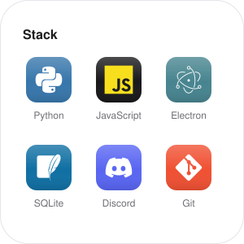

<picture>
  <source media="(prefers-color-scheme: dark)" srcset="assets/hero-escuro.svg">
  
</picture>

<a href="https://github.com/3hic/Bot-discord"><picture><source media="(prefers-color-scheme: dark)" srcset="assets/widget-projeto-escuro.svg"></picture></a>
<picture><source media="(prefers-color-scheme: dark)" srcset="assets/widget-stack-escuro.svg"></picture>
<picture><source media="(prefers-color-scheme: dark)" srcset="assets/widget-agora-escuro.svg"></picture>

<picture>
  <source media="(prefers-color-scheme: dark)" srcset="assets/sobre-escuro.svg">
  
</picture>

