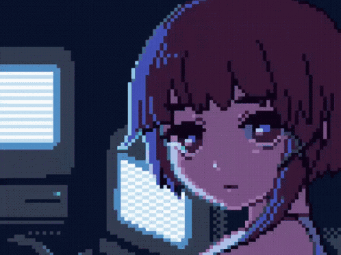

<!-- serial experiments 3hic: present day, present time. Os SVGs saem de gerador/gerar.py -->

<picture>
  <source media="(prefers-color-scheme: dark)" srcset="assets/hero-escuro.svg">
  
</picture>

<picture>
  <source media="(prefers-color-scheme: dark)" srcset="assets/navi-escuro.svg">
  
</picture>

<a href="https://github.com/3hic/Bot-discord"><picture><source media="(prefers-color-scheme: dark)" srcset="assets/card-society-escuro.svg"></picture></a>
<picture><source media="(prefers-color-scheme: dark)" srcset="assets/card-protocol-escuro.svg"></picture>
<picture><source media="(prefers-color-scheme: dark)" srcset="assets/card-psyche-escuro.svg"></picture>

<picture>
  <source media="(prefers-color-scheme: dark)" srcset="assets/sobre-escuro.svg">
  
</picture>

let's all love lain

<picture>
  <source media="(prefers-color-scheme: dark)" srcset="https://streak-stats.demolab.com?user=3hic&amp;locale=pt_BR&amp;border_radius=8&amp;background=1C1A38&amp;border=34305C&amp;stroke=34305C&amp;ring=E0304E&amp;fire=E0304E&amp;currStreakNum=EFE9DC&amp;sideNums=EFE9DC&amp;currStreakLabel=ABA6DA&amp;sideLabels=ABA6DA&amp;dates=6F6B9C">
  
</picture>

<picture>
  <source media="(prefers-color-scheme: dark)" srcset="assets/rodape-escuro.svg">
  
</picture>

