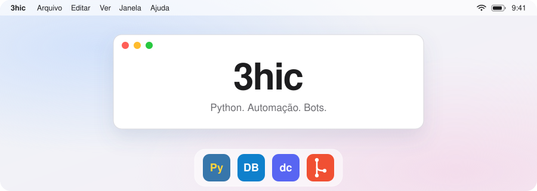
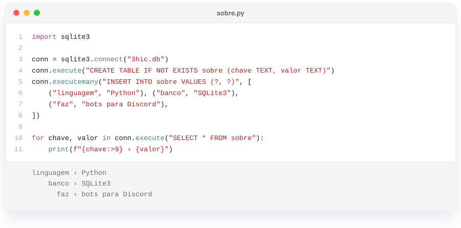

<picture>
  <source media="(prefers-color-scheme: dark)" srcset="assets/mac-escuro.svg">
  
</picture>

  

<picture>
  <source media="(prefers-color-scheme: dark)" srcset="assets/sobre-escuro.svg">
  
</picture>

 

<a href="https://github.com/3hic/Bot-discord">
<picture>
  <source media="(prefers-color-scheme: dark)" srcset="assets/projeto-escuro.svg">
  
</picture>
</a>

