<!-- serial experiments 3hic: present day, present time. Os SVGs saem de gerador/gerar.py -->

<picture>
  <source media="(prefers-color-scheme: dark)" srcset="assets/wired-hero-escuro.svg">
  
</picture>

<picture>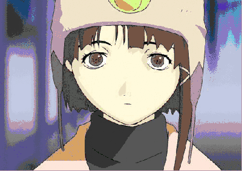</picture>
<picture>
  <source media="(prefers-color-scheme: dark)" srcset="assets/navi-escuro.svg">
  
</picture>

<a href="https://github.com/3hic/Bot-discord"><picture><source media="(prefers-color-scheme: dark)" srcset="assets/card-society-escuro.svg"></picture></a>
<picture><source media="(prefers-color-scheme: dark)" srcset="assets/card-protocol-escuro.svg">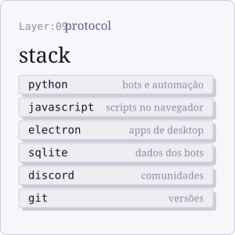</picture>
<picture><source media="(prefers-color-scheme: dark)" srcset="assets/card-psyche-escuro.svg">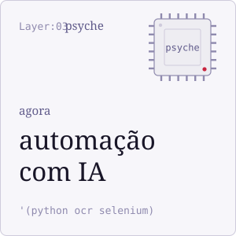</picture>

<picture>
  <source media="(prefers-color-scheme: dark)" srcset="assets/refs-escuro.svg">
  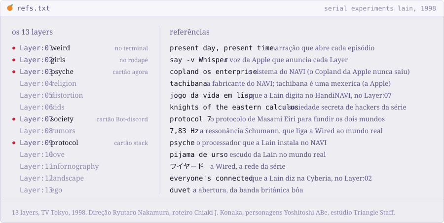
</picture>

fontes: <a href="https://pt.wikipedia.org/wiki/Serial_Experiments_Lain">Wikipédia</a>, <a href="https://en.wikipedia.org/wiki/Serial_Experiments_Lain">Wikipedia em inglês</a> e <a href="https://lain.wiki">lain.wiki</a>

<picture>
  <source media="(prefers-color-scheme: dark)" srcset="assets/sobre-lisp-escuro.svg">
  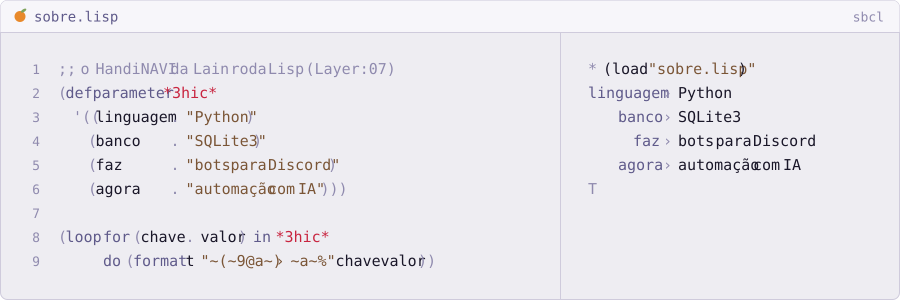
</picture>

<picture>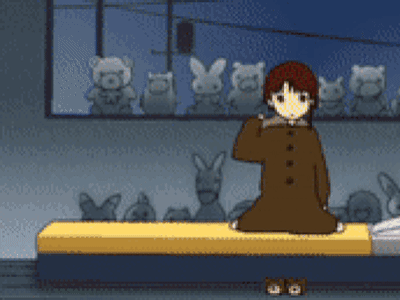</picture>
<picture>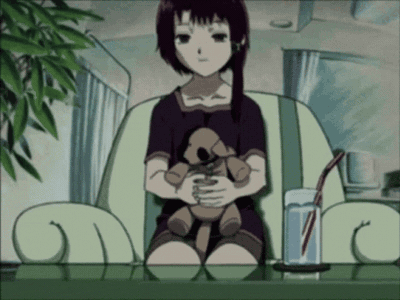</picture>
<picture>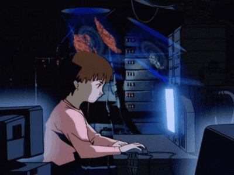</picture>

let's all love lain

<a href="https://open.spotify.com/track/42qNWdLKCI41S4uzfamhFM"><picture>
  <source media="(prefers-color-scheme: dark)" srcset="assets/player-escuro.svg">
  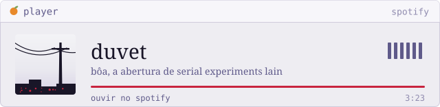
</picture></a>

<picture>
  <source media="(prefers-color-scheme: dark)" srcset="assets/rodape-escuro.svg">
  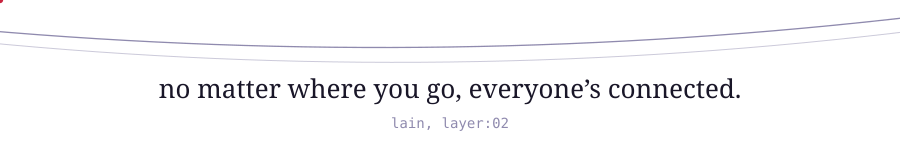
</picture>

