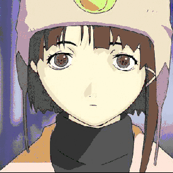
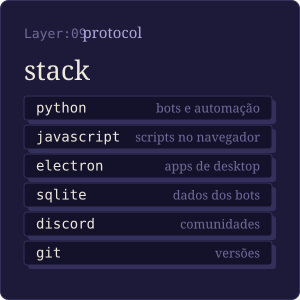
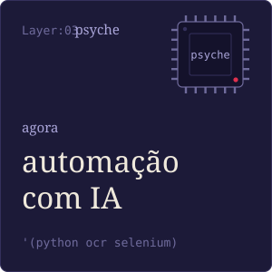
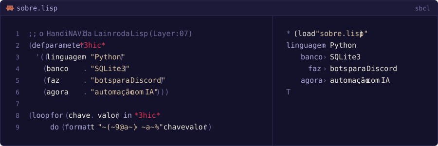
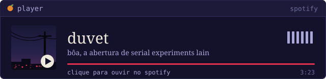
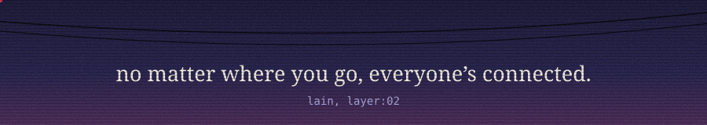

<!-- serial experiments 3hic: present day, present time. Os SVGs saem de gerador/gerar.py -->

<picture></picture>

<picture></picture>
<picture></picture>
<picture></picture>

let's all love lain

